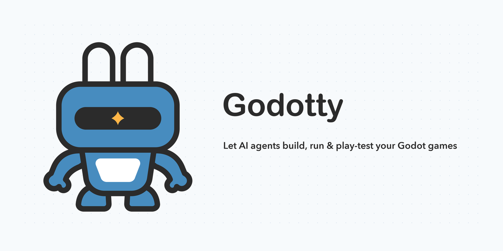

<h1 align="center">
  
</h1>

<p align="center">
  <a href="https://www.npmjs.com/package/godotty-mcp"></a>
  <a href="https://github.com/Arjein/godotty-mcp/actions/workflows/ci.yml"></a>
  
  
  <a href="LICENSE"></a>
</p>

<p align="center"><b>An MCP server that lets AI coding agents play-test your Godot 4 game — not just edit it.</b></p>

Godotty (`godotty-mcp`) connects Claude Code, Claude Desktop, Cursor and other MCP clients to a
Godot 4 project. Besides reading and editing, the agent can **run the game, see it, play it and
debug it**: take screenshots, press keys and InputMap actions with real timing, wait for
conditions, inspect and tweak live nodes, read runtime errors with backtraces, look up the class
reference _of your installed Godot version_, and run your GUT or gdUnit4 tests.

<!-- Demo GIF placeholder: a recording of an agent play-testing examples/demo-project goes here,
     e.g.  -->

> Status: **0.2.0**. Tool names and inputs may still change before 1.0.

## What makes it different

- **It sees and plays the game.** `screenshot` returns real frames (sequences too), `send_input`
  drives actions, keys and the mouse through Godot's input pipeline, `press_control` clicks a button
  by its label, `wait` blocks until `Player.position:y < 1`, and `get_node_properties` confirms
  what happened. `pause_game` and `step_game` freeze the game between calls, so an action game
  doesn't play itself while the agent thinks.
- **Diagnostics from Godot itself.** `check_scripts` uses Godot's own GDScript language server
  (errors _and_ warnings with line and column); `get_errors` captures runtime errors with full
  GDScript backtraces through Godot's Logger API, not by scraping logs.
- **Docs that match your Godot.** `godot_docs` serves signatures from your installed binary and
  descriptions from that exact engine release, so agents stop mixing up Godot 3 and 4 APIs.
- **Structured test results** for GUT and gdUnit4, including the cases both frameworks silently
  hide (test files that fail to load, tests that never reported).
- **Undoable editor edits.** With the editor plugin, every scene edit is one Ctrl/Cmd+Z step.
- **Safe by default.** Paths are confined to the project, the bridge to Godot is loopback-only and
  mutually authenticated, and no tool runs arbitrary code unless you start it with `--allow-eval`.
  See [the safety model](docs/SECURITY.md).
- **Small and cheap.** 21 tools (about 6K tokens of tool definitions), compact text outputs,
  pagination and actionable errors.

## Requirements

- Godot **4.5 or newer** (4.x), the standard editor build. Tested on 4.5.2 and 4.7.2.
- Node.js **20 or newer**.
- macOS, Linux or Windows. Screenshots need a display (on headless Linux use Xvfb).

## Quick start

Point Godotty at your project folder (the one containing `project.godot`) and your Godot
executable. If `godot` is on your `PATH` you can leave out `--godot`. The server also starts in a
folder without `project.godot` yet: project tools answer `NOT_FOUND` until it exists, then work
without a restart.

### Claude Code

```bash
claude mcp add godotty -- npx -y godotty-mcp --project /path/to/your/game --godot /path/to/Godot
```

On macOS the executable is usually `/Applications/Godot.app/Contents/MacOS/Godot`.

### Claude Desktop

Add to `claude_desktop_config.json` (Settings → Developer → Edit Config):

```json
{
  "mcpServers": {
    "godotty": {
      "command": "npx",
      "args": ["-y", "godotty-mcp", "--project", "/path/to/your/game", "--godot", "/path/to/Godot"]
    }
  }
}
```

### Cursor

Add to `.cursor/mcp.json` in your project (or the global `~/.cursor/mcp.json`):

```json
{
  "mcpServers": {
    "godotty": {
      "command": "npx",
      "args": ["-y", "godotty-mcp", "--project", "/path/to/your/game", "--godot", "/path/to/Godot"]
    }
  }
}
```

### Editor tools (optional)

The editing tools talk to the open Godot editor through a small plugin. Install it into your
project and enable it:

```bash
npx godotty-mcp install-addon --project /path/to/your/game
```

Then in Godot: **Project → Project Settings → Plugins → Godotty → Enable**. Everything else works
without the editor open.

### Try it

Ask your agent things like:

- "What's in this project? Show me the main scene."
- "Run the game, take a screenshot, hold right for a second and show me again."
- "Check all scripts for errors, then run the tests."
- "Add a Marker3D called Spawn at (2, 0, -3) to the main scene and save it."
- "How do I make a CharacterBody3D jump? Use godot_docs."

The repository's [demo project](examples/demo-project) is a ready-made playground.

## Options

| Flag                | Environment variable   | Meaning                                                                  |
| ------------------- | ---------------------- | ------------------------------------------------------------------------ |
| `--project <dir>`   | `GODOT_PROJECT_PATH`   | Godot project root (default: current directory).                         |
| `--godot <path>`    | `GODOT_PATH`           | Godot 4 executable (default: `godot` on `PATH`).                         |
| `--lsp-port <port>` | `GODOT_LSP_PORT`       | Port of the editor's GDScript language server (default 6005).            |
| `--offline`         | `GODOTTY_OFFLINE=1`    | No network: `godot_docs` shows signatures only.                          |
| `--allow-eval`      | `GODOTTY_ALLOW_EVAL=1` | Adds `eval_gdscript`, which runs arbitrary GDScript. **Off by default.** |

## Tools

| Tool                          | What it does                                                                                                     |
| ----------------------------- | ---------------------------------------------------------------------------------------------------------------- |
| **Project**                   |                                                                                                                  |
| `project_info`                | Godot version, main scene, autoloads, input map with bindings, plugins, game/editor status                       |
| `list_files`                  | Project files as `res://` paths, filtered by type and glob, paginated                                            |
| `read_scene`                  | Compact node tree of a `.tscn` with saved properties and signal connections                                      |
| `install_addon`               | Copy the editor plugin into `addons/godotty_mcp` (then enable it in Project Settings → Plugins)                  |
| **Docs & diagnostics**        |                                                                                                                  |
| `godot_docs`                  | Class reference of your installed Godot: class overviews, members (through inheritance), enums, search           |
| `check_scripts`               | GDScript errors and warnings with line:column from Godot's language server                                       |
| `get_errors`                  | Runtime errors and warnings of the last run, de-duplicated, with GDScript backtraces                             |
| **Run**                       |                                                                                                                  |
| `run_game`                    | Start the main scene or another scene (windowed or headless), with the runtime helper injected for that run only |
| `stop_game`                   | Stop the game and summarize how it ended                                                                         |
| `get_output`                  | Console output with levels, a cursor for new lines, and level/text filters                                       |
| **See & play** (running game) |                                                                                                                  |
| `screenshot`                  | Rendered frame(s) as images, scaled to a maximum size                                                            |
| `send_input`                  | Actions, keys, mouse buttons/motion, holds and waits, in order with real timing; `observe` reports value changes |
| `list_controls`               | Visible buttons and focusable controls with text, path, rect and focus/disabled state                            |
| `press_control`               | Click, focus or accept a control found by its text or path                                                       |
| `wait`                        | Frames, seconds, or until a node exists / a property or getter meets a condition                                 |
| `pause_game`                  | Freeze the game between calls (or resume it); optional `time_scale`                                              |
| `step_game`                   | Run exactly N physics frames, then stay paused                                                                   |
| `inspect_scene_tree`          | Live node tree of the game — or of the scene open in the editor (`target: editor`)                               |
| `get_node_properties`         | Property values (and zero-argument getters like `is_open()`) of a live node, game or editor                      |
| `set_node_property`           | Change live properties in the running game (not saved)                                                           |
| **Editor** (needs the plugin) |                                                                                                                  |
| `open_scene`                  | Open a scene in the editor, or create a new one                                                                  |
| `add_node`                    | Add a node by class or as a scene instance, with properties — undoable                                           |
| `remove_node`                 | Remove a node — undoable                                                                                         |
| `update_node`                 | Properties, rename, reparent, attach/detach script in one undoable step                                          |
| `save_scene`                  | Save the edited scene (or save as)                                                                               |
| **Tests**                     |                                                                                                                  |
| `run_tests`                   | Run GUT or gdUnit4 headless (optionally `fixed_fps`); totals, failures with file:line, skipped and missing tests |
| **Opt-in**                    |                                                                                                                  |
| `eval_gdscript`               | Run GDScript in the game or editor (only with `--allow-eval`)                                                    |

## Safety

Godotty confines file access to the project, keeps its connection to Godot on `127.0.0.1` with
per-session tokens and a server proof, refuses value literals that could load and run scripts, and
only offers code execution when you pass `--allow-eval`. Editor edits are undoable.

Running or testing a project runs that project's code, as it would in the editor. Read
[docs/SECURITY.md](docs/SECURITY.md) for the full model and its limits.

## Troubleshooting

| Problem                                | Fix                                                                                                                             |
| -------------------------------------- | ------------------------------------------------------------------------------------------------------------------------------- |
| `GODOT_NOT_FOUND`                      | Pass `--godot` with the full path to the Godot executable (inside `Godot.app/Contents/MacOS/` on macOS).                        |
| "not supported; godotty-mcp needs 4.5" | Install Godot 4.5 or newer.                                                                                                     |
| `EDITOR_NOT_CONNECTED`                 | Open the project in Godot, install the plugin (`npx godotty-mcp install-addon`) and enable it under Project Settings → Plugins. |
| Screenshot says the game runs headless | Run with `run_game` `headless: false`; on a headless Linux machine start the client under Xvfb.                                 |
| The first `check_scripts` is slow      | Godot imports the project the first time; later calls reuse a warm language server.                                             |
| `run_tests` finds no framework         | Install GUT (`addons/gut`) or gdUnit4 (`addons/gdUnit4`) from the Asset Library.                                                |
| `godot_docs` has no descriptions       | You are offline or using a build without published docs; signatures are still exact.                                            |
| The game window grabs focus            | Expected for windowed runs; use `headless: true` when you don't need screenshots.                                               |

## Contributing

Contributions are welcome — see [CONTRIBUTING.md](CONTRIBUTING.md) and
[docs/ARCHITECTURE.md](docs/ARCHITECTURE.md) (components, bridge protocol, how to add a tool).

## License

[MIT](LICENSE)
